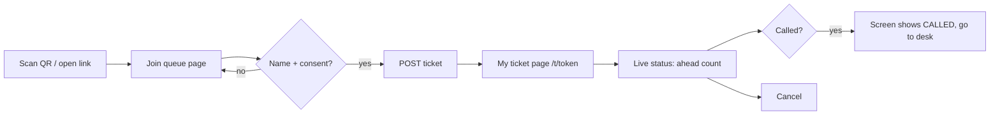
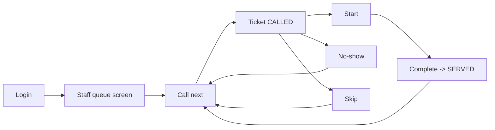
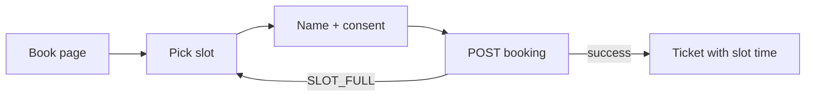
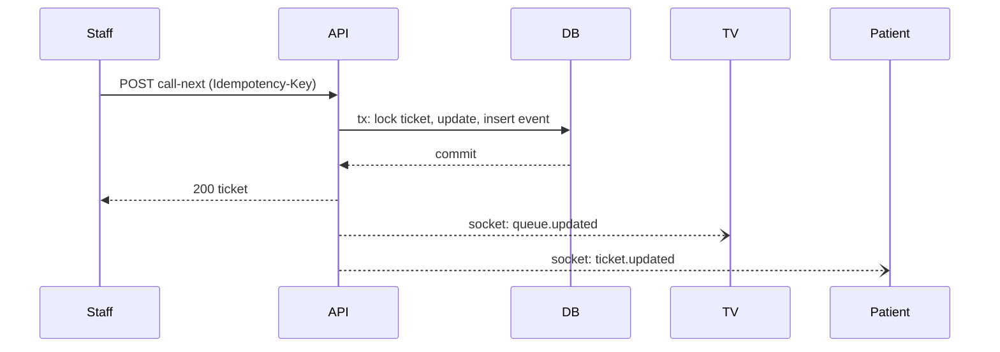

# App Flow

Status: Final v1.0 · Last updated: 2026-11-05

## Screens
| Screen | Route | Who | Stories |
|---|---|---|---|
| Login | `/login` | Staff, Admins | US-4 |
| Super Admin: tenants | `/admin/tenants` | Super Admin | US-1 |
| Clinic Admin: staff | `/clinic/staff` | Clinic Admin | US-2 |
| Clinic Admin: service points & slots | `/clinic/service-points` | Clinic Admin | US-3, US-8 |
| Staff queue | `/staff/:servicePointId` | Staff | US-9..US-14 |
| TV display | `/tv/:servicePointId` | Public | US-16 |
| Join queue | `/c/:tenantSlug/:servicePointCode` | Patient | US-5 |
| Book slot | `/c/:tenantSlug/book` | Patient | US-8 |
| My ticket | `/t/:token` | Patient | US-6, US-7 |

## Flow 1: Walk-in patient

## Flow 2: Staff serving

## Flow 3: Booking

## Flow 4: Real-time

## UI rules
- Staff screen has big targets and keyboard shortcut (Space = call next). Button disables while a request is in flight and reuses the same idempotency key on retry.
- TV shows ticket numbers only, never names or phones.
- Patient page works on slow mobile: small bundle, no heavy assets, falls back to polling if the socket drops.
- Staff screen shows a "reconnecting" banner and refetches (TanStack Query) after reconnect.
