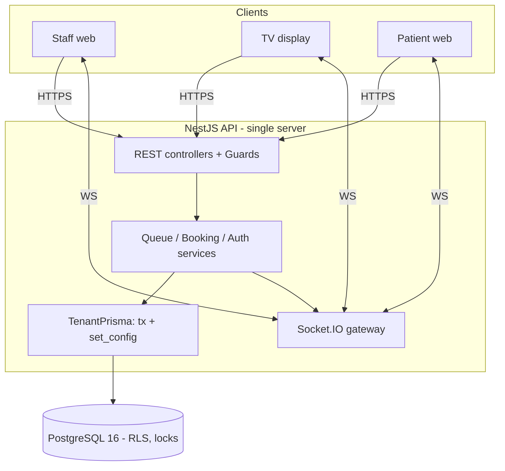
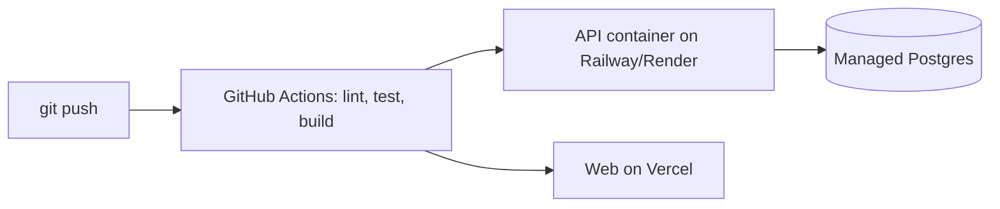

# Technical Requirements & High-Level Design (TRD + HLD)

Status: Draft · Last updated: 2026-11-05

## 1. Stack
| Layer | Choice | Notes |
|---|---|---|
| Frontend | React + Vite + TS, Tailwind, shadcn/ui | Known stack |
| Server state | TanStack Query | Refetch after reconnect |
| Client state | Zustand | Small UI state |
| Backend | NestJS + TS | Modules, Guards |
| DB / ORM | PostgreSQL 16 + Prisma | Raw SQL for RLS, locking |
| Real-time | Socket.IO, single server | Rooms per service point |
| Validation | Zod in `packages/shared` | Shared by API and web |
| Tests | Jest, Testcontainers, k6 | Playwright later |
| DevOps | Docker Compose, GitHub Actions | |
| Hosting | Railway/Render (API+DB), Vercel (web) | Free/cheap tiers |
| Logs | Pino, `/health` | Sentry post-MVP |

Post-MVP: Redis, BullMQ, `@socket.io/redis-adapter`, SMS gateway, Python/pandas, Toxiproxy.

## 2. Architecture

## 3. Modules (NestJS)
| Module | Responsibility |
|---|---|
| `auth` | Login, JWT, `RolesGuard`, `TenantContext` |
| `tenants` | Super Admin tenant CRUD |
| `users` | Staff/admin CRUD |
| `service-points` | Service point CRUD |
| `slots` | Slot CRUD, booking (row lock) |
| `tickets` | Issue, cancel, public ticket view by token |
| `queue` | Call next, start, complete, no-show, skip (locks + events) |
| `events` | Append-only event writer, reader |
| `idempotency` | Interceptor + store for `Idempotency-Key` |
| `realtime` | Socket.IO gateway, room management, emit after commit |
| `privacy` | Consent, purge job |
| `health` | `/health` |
| `db` | `TenantPrisma`, SQL helpers |

## 4. Key design decisions (see ADRs)
- **Tenancy via RLS** with per-request transaction `set_config('app.tenant_id', $1, true)`; app connects as non-owner role (ADR-001).
- **Event log as source of truth**; projection is the `tickets` table (ADR-002).
- **Concurrency with `FOR UPDATE SKIP LOCKED`** for call-next and `FOR UPDATE` for slots (ADR-003).
- **Idempotency keys** stored in Postgres (ADR-004).
- **No Redis in MVP**; single Socket.IO server (ADR-005).

## 5. Request lifecycle (queue-changing)
1. Guard authenticates JWT, extracts `tenantId`, `userId`, `role`.
2. Idempotency interceptor reads `Idempotency-Key`.
3. `TenantPrisma.run(tenantId, tx => ...)` opens a transaction and sets `app.tenant_id`.
4. Inside the transaction: claim idempotency key → lock row(s) → validate transition → update ticket → insert event → store idempotent response.
5. Commit.
6. **After commit**, emit Socket.IO event to room `sp:{servicePointId}`.

Emit happens after commit so clients never see state that was rolled back. If the process crashes between commit and emit, clients recover via refetch (TanStack Query on reconnect + periodic fallback).

## 6. Real-time design
- Rooms: `sp:{servicePointId}` (staff + TV), `ticket:{ticketId}` (one patient).
- Events: `queue.updated` (payload: snapshot version + changed ticket), `ticket.updated`.
- Clients treat socket messages as hints and refetch the snapshot (simple and correct). Optimization to apply deltas is optional.
- Socket auth: staff via JWT; TV via service point public id (read-only room); patient via ticket token.

## 7. Multi-tenant access for unauthenticated users
Patient/TV endpoints have no JWT. Tenant is resolved from `tenantSlug` or ticket token by a lookup that does not require tenant context:
- `tenants` is readable by slug without RLS filtering by `app.tenant_id` (only `id`, `slug`, `name` exposed).
- Ticket token lookup uses a narrow RLS policy `ticket_token_lookup` (SELECT only, `access_token = current_setting('app.ticket_token')`). The app sets `app.ticket_token` transaction-locally, reads that one ticket, learns `tenant_id`, then continues in a normal tenant-scoped transaction. (Chosen over a `SECURITY DEFINER` function: with `FORCE ROW LEVEL SECURITY` the function owner is still filtered, and a policy keeps everything inside RLS.)
- Login uses the same pattern: policy `users_login_lookup` (SELECT only, `email = current_setting('app.login_email')`), so the app can find one user by email before any tenant is known.

## 8. Non-functional design
| NFR | Design |
|---|---|
| Correctness | Row locks, unique constraints, CHECK constraints, transactions |
| Crash recovery | All state in Postgres; API stateless apart from sockets |
| Privacy | Minimal data; consent table; purge job |
| Observability | Pino logs with request id; `/health` |
| Rate limiting | `@nestjs/throttler` on public endpoints (in-memory for MVP) |

## 9. Deployment view

Local: `docker compose up` → postgres, api, web.

## 10. Risks
See [risks-and-cuts](../plan/risks-and-cuts.md).
