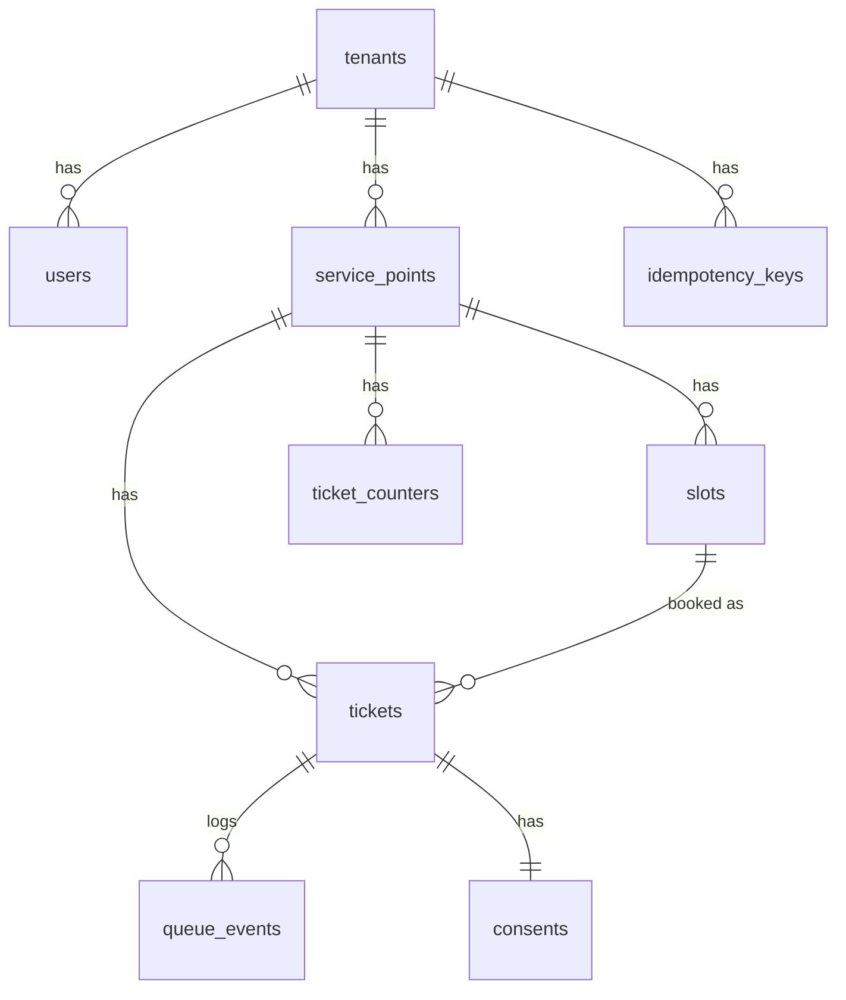

# Database Schema

Status: Final v1.1 · Last updated: 2026-11-05

PostgreSQL 16. Prisma defines the tables; RLS, triggers, and extra constraints are hand-written SQL in migrations.

## 1. ERD


## 2. Tables (MVP)

### tenants
| Column | Type | Notes |
|---|---|---|
| id | uuid PK | |
| slug | text UNIQUE NOT NULL | used in public URLs |
| name | text NOT NULL | |
| is_active | boolean default true | |
| created_at | timestamptz default now() | |

### users
| Column | Type | Notes |
|---|---|---|
| id | uuid PK | |
| tenant_id | uuid FK tenants NULL | NULL only for SUPER_ADMIN |
| email | citext UNIQUE NOT NULL | |
| password_hash | text NOT NULL | argon2/bcrypt |
| role | enum `SUPER_ADMIN, CLINIC_ADMIN, STAFF` | |
| is_active | boolean default true | |
| created_at | timestamptz | |

CHECK: `(role = 'SUPER_ADMIN') = (tenant_id IS NULL)`.

### service_points
| Column | Type | Notes |
|---|---|---|
| id | uuid PK | |
| tenant_id | uuid FK NOT NULL | |
| name | text NOT NULL | |
| code | text NOT NULL | URL-safe; UNIQUE(tenant_id, code) |
| prefix | text NOT NULL | ticket prefix, e.g. `A`; UNIQUE(tenant_id, prefix) |
| max_waiting | int NOT NULL default 200 | CHECK > 0; join returns `QUEUE_FULL` beyond this |
| is_active | boolean default true | |

### slots
| Column | Type | Notes |
|---|---|---|
| id | uuid PK | |
| tenant_id | uuid FK NOT NULL | |
| service_point_id | uuid FK NOT NULL | |
| starts_at | timestamptz NOT NULL | |
| capacity | int NOT NULL | CHECK capacity > 0 |
| booked_count | int NOT NULL default 0 | **CHECK booked_count BETWEEN 0 AND capacity** |

### ticket_counters
Per service point, per local day sequence.
| Column | Type | Notes |
|---|---|---|
| service_point_id | uuid FK | PK part |
| queue_date | date | PK part (clinic local date) |
| last_seq | int NOT NULL default 0 | |

Issue number: `INSERT ... ON CONFLICT (service_point_id, queue_date) DO UPDATE SET last_seq = ticket_counters.last_seq + 1 RETURNING last_seq`. The upsert locks the row, so concurrent issuers get distinct values (INV-1).

### tickets
| Column | Type | Notes |
|---|---|---|
| id | uuid PK | |
| tenant_id | uuid FK NOT NULL | |
| service_point_id | uuid FK NOT NULL | |
| slot_id | uuid FK NULL | set for booked tickets |
| queue_date | date NOT NULL | |
| seq | int NOT NULL | |
| number | text NOT NULL | `prefix-seq` e.g. `A-023` |
| status | enum `WAITING, CALLED, SERVING, SERVED, SKIPPED, NO_SHOW, CANCELLED` | |
| patient_name | text NULL | name or nickname; set to NULL after 30 days (INV-9) |
| phone | text NULL | set to NULL after 30 days (INV-9) |
| access_token | text UNIQUE NOT NULL | random ≥128-bit, for guest link |
| issued_at | timestamptz | |
| called_at / started_at / completed_at | timestamptz NULL | |
| called_by | uuid FK users NULL | |
| version | int default 0 | increments on each change (client snapshot hint) |

Constraints: UNIQUE(service_point_id, queue_date, seq) (INV-1). Index `(service_point_id, status, seq)` for call-next.

### queue_events (append-only)
| Column | Type | Notes |
|---|---|---|
| id | bigserial PK | ordering |
| tenant_id | uuid NOT NULL | |
| service_point_id | uuid NOT NULL | |
| ticket_id | uuid NOT NULL | |
| type | enum `TICKET_ISSUED, CALLED, STARTED, SERVED, SKIPPED, NO_SHOW, CANCELLED, TRANSFERRED` | |
| actor_user_id | uuid NULL | NULL for patient actions |
| actor_kind | enum `STAFF, PATIENT, SYSTEM` | |
| payload | jsonb default '{}' | no PII beyond ticket number |
| created_at | timestamptz default now() | |

Append-only enforcement (INV-6): app role has only `INSERT, SELECT`; a trigger raises on `UPDATE`/`DELETE`/`TRUNCATE`.

### consents
| Column | Type | Notes |
|---|---|---|
| id | uuid PK | |
| tenant_id | uuid | |
| ticket_id | uuid UNIQUE FK | |
| text_version | text | version of consent text shown |
| accepted_at | timestamptz | |

Consent rows are kept after phone purge (no phone in this table).

### idempotency_keys
| Column | Type | Notes |
|---|---|---|
| tenant_id | uuid | PK part |
| key | text | PK part |
| endpoint | text | e.g. `POST /queue/:id/call-next` |
| request_hash | text | detects key reuse with different body |
| response_status | int NULL | set before commit; every committed row has a response (ADR-004) |
| response_body | jsonb NULL | |
| created_at | timestamptz | purge after 24h |

### audit_runs (append-only)
| Column | Type | Notes |
|---|---|---|
| id | uuid PK | |
| tenant_id | uuid NOT NULL | RLS like other tenant tables |
| ran_at | timestamptz default now() | |
| trigger | text | `manual`, `nightly`, `ci` |
| passed | boolean | all checks passed |
| results | jsonb | per-check results (see invariant-auditor.md) |

App role has INSERT, SELECT only.

### Booking and cancellation
Cancelling a ticket that holds a slot (`slot_id IS NOT NULL`) decrements `slots.booked_count` in the same transaction, after taking the slot's `FOR UPDATE` lock (decision D-29). Auditor check A-4 compares `booked_count` to the number of non-cancelled tickets holding the slot.

## 3. Post-MVP tables (not built yet)
`visits`, `visit_flows`, `visit_flow_stages` (see multi-stage-visits.md), `outbox_messages`, `sms_inbound` (see sms-outbox-design.md), and `tickets.lane` / service point lane settings (see priority-lanes.md).

## 4. Row-Level Security
Roles:
- `queueless_owner` — owns tables, runs migrations. **Bypasses RLS. App never connects as this role.**
- `queueless_app` — non-owner, `NOSUPERUSER NOBYPASSRLS`; used by the API.

For every tenant-scoped table (`users`, `service_points`, `slots`, `ticket_counters`*, `tickets`, `queue_events`, `consents`, `idempotency_keys`):
```sql
ALTER TABLE tickets ENABLE ROW LEVEL SECURITY;
ALTER TABLE tickets FORCE ROW LEVEL SECURITY;
CREATE POLICY tenant_isolation ON tickets
  USING (tenant_id = current_setting('app.tenant_id', true)::uuid)
  WITH CHECK (tenant_id = current_setting('app.tenant_id', true)::uuid);
```
\*`ticket_counters` has no `tenant_id`; add it (denormalized) so the same policy applies.

If `app.tenant_id` is unset, `current_setting(..., true)` returns NULL → no rows match (fail closed).

Super Admin operations on `tenants`/`users` use a separate code path with `app.is_super_admin = 'true'` and policies that allow it; keep this path tiny and tested.

Extra narrow policies (implemented in `apps/api/prisma/migrations/20261105000100_rls_and_constraints`):
- `tickets.ticket_token_lookup` — SELECT where `access_token = app.ticket_token` (guest ticket page, before tenant is known).
- `users.users_login_lookup` — SELECT where `email = app.login_email` (login).
- `tenants.tenants_read` — public SELECT (slug/name only are exposed by the API); writes need `app.is_super_admin`.

Implementation notes: emails are stored lowercase (CHECK) instead of `citext`; `ticket_counters` carries a denormalized `tenant_id`; the app role `queueless_app` is created by the migration without a password (set it out-of-band with `ALTER ROLE`). Migrations run with `DATABASE_URL` pointed at the owner role; the API runs with the app role.

Request wrapper:
```ts
await prisma.$transaction(async (tx) => {
  await tx.$executeRaw`SELECT set_config('app.tenant_id', ${tenantId}, true)`;
  return fn(tx);
});
```
`true` = transaction-local, so the value cannot leak to the next request on a pooled connection.

## 5. Critical SQL

### Call next (INV-3)
```sql
SELECT id FROM tickets
WHERE service_point_id = $1 AND queue_date = $2 AND status = 'WAITING'
ORDER BY seq
FOR UPDATE SKIP LOCKED
LIMIT 1;
-- then UPDATE tickets SET status='CALLED', called_at=now(), called_by=$3, version=version+1 WHERE id=$id;
-- then INSERT INTO queue_events (...) VALUES (... 'CALLED' ...);
```
`SKIP LOCKED` makes three simultaneous staff each lock a different row instead of waiting on the same one.

### Book slot (INV-5)
```sql
SELECT id, capacity, booked_count FROM slots WHERE id = $1 FOR UPDATE;
-- if booked_count >= capacity -> SLOT_FULL
UPDATE slots SET booked_count = booked_count + 1 WHERE id = $1;
```
The CHECK constraint is the last line of defense if app code ever has a bug.

### Transition guard
Every UPDATE of status includes the expected current status: `WHERE id=$1 AND status = ANY($allowed_from)`; zero rows updated → `INVALID_TRANSITION`.

## 6. Invariants
| ID | Invariant | Enforced by |
|---|---|---|
| INV-1 | Ticket number unique per service point per day | UNIQUE + counter upsert |
| INV-2 | A ticket reaches exactly one final state; final states have no exits | Transition table + guarded UPDATE |
| INV-3 | Concurrent call-next never returns the same ticket | `FOR UPDATE SKIP LOCKED` |
| INV-4 | Same idempotency key → one effect, same response | `idempotency_keys` PK + stored response |
| INV-5 | `booked_count <= capacity` always | Row lock + CHECK |
| INV-6 | `queue_events` is append-only | Role grants + trigger |
| INV-7 | No cross-tenant access | RLS (forced) + non-owner role + app checks |
| INV-8 | Every status change has exactly one event in the same transaction | Single service method; integration test counts events |
| INV-9 | Patient name and phone cleared (set NULL) 30 days after issue | Scheduled purge job + auditor A-7 |

## 7. Indexes
- `tickets (service_point_id, queue_date, status, seq)`
- `tickets (access_token)` unique
- `queue_events (ticket_id, id)`, `queue_events (service_point_id, id)`
- `slots (service_point_id, starts_at)`
- `idempotency_keys (created_at)` for purge

## 8. Retention
- `tickets.patient_name` and `tickets.phone` set to NULL 30 days after `issued_at` (INV-9). The ticket row, number, timestamps, and events stay (they contain no personal data) so analytics and the audit trail survive.
- `idempotency_keys` deleted after 24 hours.
- Events keep ticket number only, no name or phone.
