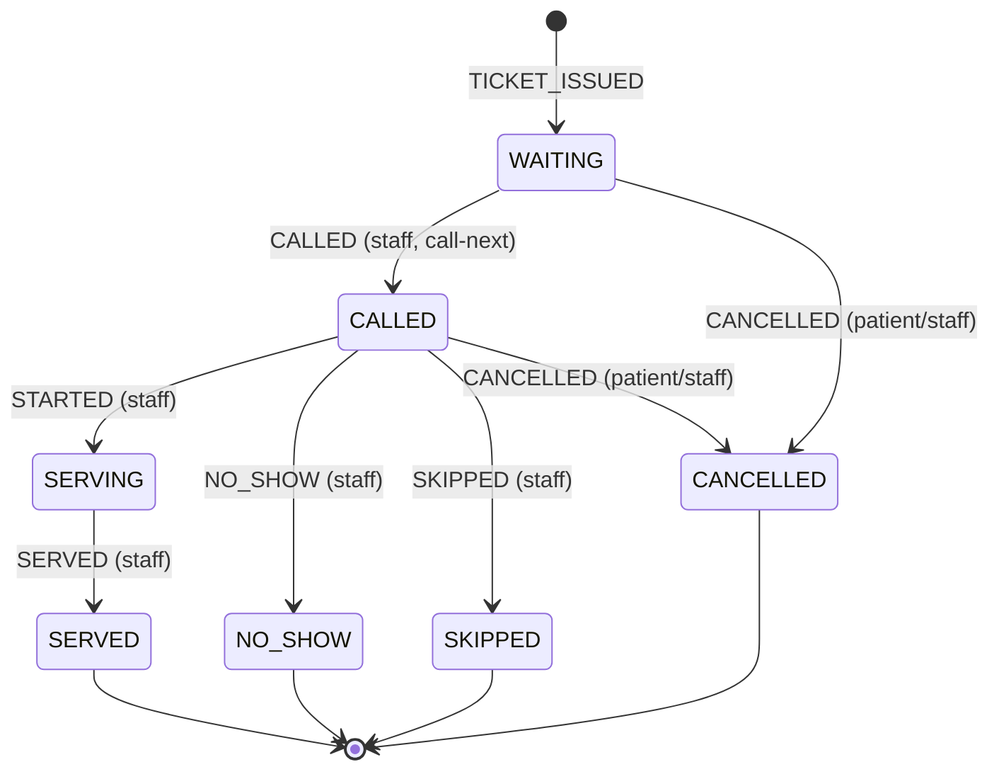

# Ticket State Machine

Status: Final v1.0 · Last updated: 2026-11-05

## Diagram

## Transition table
| From | Event | To | Who | Notes |
|---|---|---|---|---|
| (none) | TICKET_ISSUED | WAITING | Patient / Staff | Creates ticket, counter upsert, consent |
| WAITING | CALLED | CALLED | Staff | `SKIP LOCKED` selection |
| WAITING | CANCELLED | CANCELLED | Patient / Staff | |
| CALLED | STARTED | SERVING | Staff | |
| CALLED | NO_SHOW | NO_SHOW | Staff | |
| CALLED | SKIPPED | SKIPPED | Staff | Final in MVP |
| CALLED | CANCELLED | CANCELLED | Patient / Staff | |
| SERVING | SERVED | SERVED | Staff | |

Final states: `SERVED, NO_SHOW, SKIPPED, CANCELLED`. No outgoing transitions (INV-2).

Any other transition returns `409 INVALID_TRANSITION` and writes no event.

## Post-MVP
- `SERVING → TRANSFERRED`: closes the current stage ticket and issues a new ticket at the next stage (multi-stage visits). `TRANSFERRED` becomes a final state for the old ticket.
- Auto no-show: a CALLED ticket not started within 10 min (per-tenant config) becomes NO_SHOW via a job (decision D-12). See [multi-stage-visits](multi-stage-visits.md) for TRANSFERRED.
- Recall: SKIPPED stays final in v1 (decision D-3). Not planned.

## Rules
1. Each transition = one guarded `UPDATE ... WHERE status = ANY(allowed_from)` + one event row, same transaction (INV-8).
2. `version` increments on every change.
3. Projection can be rebuilt: replay `queue_events` per ticket in `id` order; the last event type maps to the status. A test verifies the replayed status equals `tickets.status` for all tickets after a simulated day.
